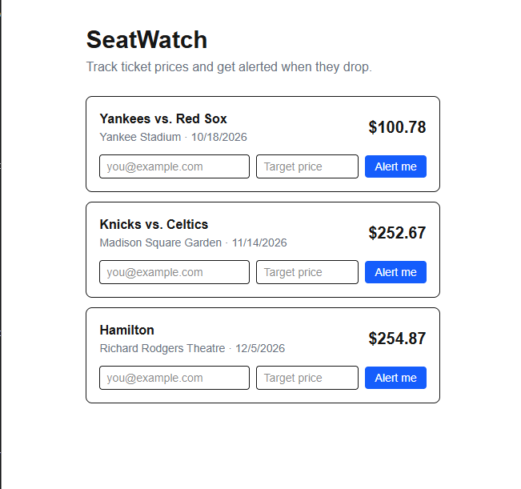

# SeatWatch

A ticket price tracker. Pick an event, set a target price, and get alerted
when the lowest ticket price drops to it.



## What it does

- Lists events with their current lowest ticket price
- Lets a visitor create a price alert for any event
- Runs a background job every 30 seconds that updates prices and triggers
  any alerts whose target has been reached

Prices are simulated: the background job moves each one up or down by up
to 10% to imitate a live market. Triggered alerts are written to the
server log. See the roadmap for what's next.

## Tech stack

| Part       | Technology                              |
|------------|-----------------------------------------|
| API        | C#, ASP.NET Core (minimal APIs)         |
| Database   | PostgreSQL, Entity Framework Core       |
| Background | .NET `BackgroundService`                |
| Website    | Next.js (App Router), TypeScript, Tailwind CSS |

## How it works

- **API (`/api`)**: REST endpoints for events and alerts. Alert requests
  are validated on the server, and a request DTO limits which fields a
  client can set.
- **Database**: two tables, `Events` and `PriceAlerts`, linked by a
  foreign key. The schema is managed with EF Core migrations.
- **Background job**: creates its own dependency-injection scope on each
  run to get a fresh database context, then finds triggered alerts with
  a single filtered query.
- **Website (`/web`)**: the events list is a server component that
  fetches fresh data on every request. The alert form is a client
  component that posts to the API, which allows the site's origin
  through a CORS policy.

## API endpoints

| Method | Path           | Description                         |
|--------|----------------|-------------------------------------|
| GET    | `/events`      | List all events                     |
| GET    | `/events/{id}` | Get one event (404 if not found)    |
| GET    | `/alerts`      | List all alerts                     |
| POST   | `/alerts`      | Create an alert (400 if invalid)    |

## Running it locally

You need the .NET SDK, Node.js and PostgreSQL installed.

1. Create a PostgreSQL database named `seatwatch`.
2. Set up and start the API:
```
   cd api
   dotnet user-secrets set "ConnectionStrings:SeatWatch" "Host=localhost;Port=5432;Database=seatwatch;Username=postgres;Password=YOUR_PASSWORD"
   dotnet ef database update
   dotnet run
```
3. In `web`, create a file named `.env.local`:
```
   API_URL=http://localhost:5073
   NEXT_PUBLIC_API_URL=http://localhost:5073
```
4. Start the website:
```
   cd web
   npm install
   npm run dev
```
5. Open http://localhost:3000.

## Roadmap

- Pull real event data from a public events API
- Send alert emails
- Add automated tests
- Deploy to Azure

## How I used AI

I built this project with Claude as a pair programmer and tutor while
learning C# and Next.js. [AI-NOTES.md](AI-NOTES.md) describes how I
worked and what I had to debug along the way.